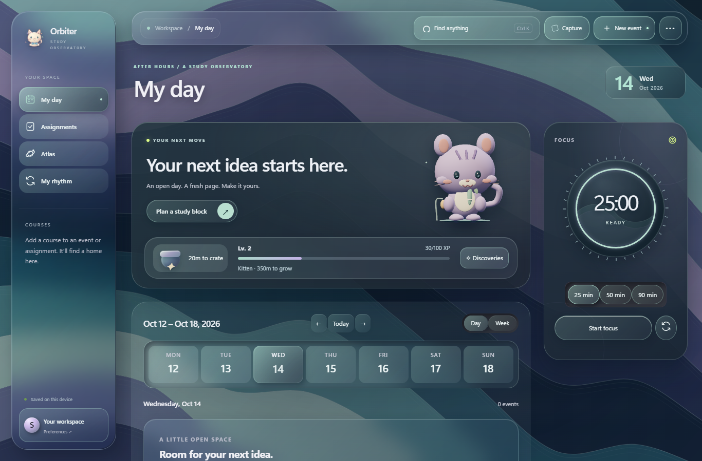
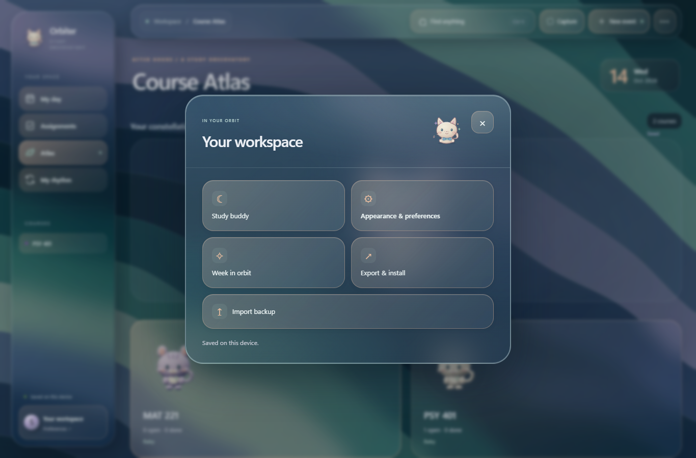
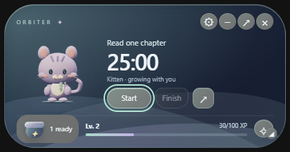

# Orbiter 0.3.1 — A clearer space to study

Orbiter 0.3.1 brings a more consistent glass interface, a redesigned Workspace menu, and smoother movement between the planner and your floating study buddy.

## What's new

### One look across your workspace

- Accent-tinted glass buttons throughout the planner, buddy, and rewards, with clear selected, disabled, and keyboard-focus states.
- Transparent glass course notes and a cleaner confidence slider.
- Rounded calendar surfaces in Solid mode, with opaque alternatives for reduced transparency.
- My Rhythm now follows your selected Mint, Lilac, or Apricot accent.

### A redesigned Workspace menu

Find Study Buddy, preferences, your weekly review, and export tools in a compact glass command deck. Secondary import and recovery actions stay grouped, and the layout adapts to smaller screens.

### Your cat takes you home

In the Windows application, click the main My Day cat to return to the floating buddy. Click the buddy's cat to reopen the planner—all inside the same application. Enter and Space work too, and switching modes preserves your timer and open drafts.

## Fixes and polish

- Separated the Discoveries header from its scrolling collection to prevent overlapping controls.
- Improved crate and level-bar spacing.
- Fixed wrapping on the **+ Test** action.
- Removed long fractional-minute values from weekly review labels without changing recorded focus precision.
- Removed retired spinning sculpture code and obsolete visual rules while preserving the animated cat fallback.
- Added a safeguard so release measurements cannot hide or quit an existing Orbiter session.

## Updating

Download **Orbiter Setup.exe** from the release assets and close Orbiter through **Quit** in the tray before installing. The Windows x64 installer installs for the current user; running Orbiter does not require an open browser, Python, or Node.js.

This patch retains the existing database location, study records, cat identities, and owned cosmetics. Export a backup from Workspace if you would like a separate copy before updating.

## Release checks

Both automated UI suites and all **21 Rust tests** passed, covering mode switching, draft preservation, theme behavior, wave transitions, timer accounting, rewards, persistence, and local pairing protections.

This is an **unsigned Windows build**. Hands-on checks for Windows display scaling, multiple monitors, pinning, and installer upgrades remain pending. Visible-window memory optimization is ongoing; the previous 200 MB target has not yet been met.

*Screenshots use demonstration data.*
