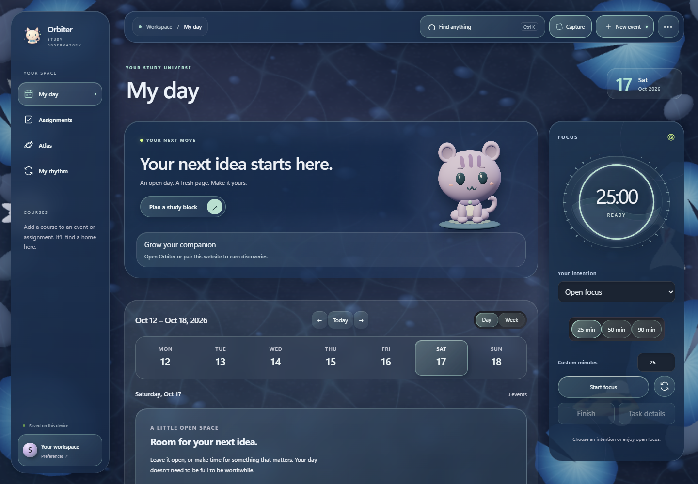

# Orbiter 0.5.0 · Stillwater

**A blue pond workspace, an expressive collectible kitten, and a clearer study flow.**

## A living pond across the full app

- Replace the aurora wallpaper with the midnight-blue lily pond in My Day, Atlas, assignments, My Rhythm, dialogs and the native planner.
- Original koi, veined blue lily pads, a pale water lily and a fine mineral bed sit beneath restrained water lighting.
- Low-opacity mist covers the whole pond, with a visible slow drift and local cursor-driven dispersal. Preserve quieter reading surfaces and stable controls.
- The compact buddy shares the same scene and preferences. Use one WebGL renderer for pond and cat, with a small background presentation canvas; pause hidden rendering and honor reduced motion, quiet mode and Low quality.
- Keep the three lighting presets, appearance Apply/Cancel, selected accents and opaque material alternatives.

## Companion and study refinements included

- Original soft 3D kitten with individual course identities, growth stages, blinking, attention, typing paws and study/reward reactions.
- Persistent rewards, cosmetics and habitat props, with preview/equip handling and duplicate protection.
- Unified My Day intention, native timer authority, automatic compact-mode Start/Resume, and latest-session recaps.
- Existing tasks, tests, notes, courses, inventory and database identifier are preserved.

## Performance status

The native buddy averaged 0.70% CPU and tray idle 0%. Visible memory remains above target (373 MB buddy / 538 MB planner), and the first buddy startup was 3.35 seconds. See [verification details](VERIFICATION-0.5.0.md); this build is not a claim that all resource or live-release gates are complete.

## Installing

Save edits and **Quit Orbiter from the tray** before running `Orbiter_0.5.0_x64-setup.exe`. Closing the window alone leaves the old process running.

0.5.0 is the user-selected release following 0.4.2. The local 0.6.x builds were unreleased design iterations, not the public version sequence. Anyone who installed one of those local iterations must run this installer manually; the updater will not offer a lower semantic version.

The personal installer is not Authenticode signed. Updater artifacts use the existing verification key. Nothing is published, deployed or committed by this build. See the 0.5 verification report for checked scenarios and remaining resource/live-validation limits.

---

## Earlier refinement notes included in this release

# Orbiter 0.5.0 · A little more alive

**A clearer study flow, a more personal space, and a companion that grows with your work.**

## Study with one intention

- My Day and the timer share your selected intention.
- Start, Pause/Resume, Finish, and task details stay in predictable places.
- Choose a preset or custom duration. Active and paused sessions retain their original intention until finished.
- Native Start/Resume still returns the same window to the floating buddy after the timer accepts the action.

## Preview your atmosphere

Open **Appearance studio** from preferences or buddy options.

- Explore **Tidal Night**, **Lunar Mist**, and **Opal Dawn**.
- Preview planner and buddy styling with your accent, material, and atmosphere strength.
- Apply when ready, cancel to restore saved choices, or reset appearance without changing your data or companion.
- Scene and atmosphere preferences participate in backups and account sync after the supplied database migration is applied.

## Watch your habitat grow

Resting stone → tidal pool → lantern and plants → celestial garden.

Habitats use existing growth milestones at **0, 2, 8, and 20 hours**. Course identities, cosmetic ownership, and reward rules are preserved. A static fallback retains identity and habitat stage when WebGL is unavailable.

## See what a session accomplished

- A recap shows actual focus, applicable exam preparation reduction, rewards, and growth.
- Early finishes count actual focused time. Midnight records belong to one session.
- Pending account rewards are labeled; confirmed account totals are distinguished from locally earned session rewards.
- Done acknowledges the recap. Revisit it from **Latest session** without duplicating credit or replaying celebrations.

## Faster everyday interactions

Routine menus and editors use short local transitions. Full waves remain for major scene changes and weekly review; input is available immediately. Reward requests no longer wait through an artificial reveal delay.

## Install and sync

Save your work, **Quit Orbiter from the tray**, and run the versioned Windows x64 installer. Existing data stays in the same application-data location. The installer is not Authenticode signed; update packages use Orbiter's existing updater-verification key.

**Account sync remains beta.** The hosted Supabase project needs the new appearance migration before syncing the new preferences. This build does not deploy that migration, publish GitHub assets, or update Cloudflare automatically. Live multi-device sync, a published automatic upgrade, and physical multi-monitor/display-scaling checks remain release-promotion requirements.
