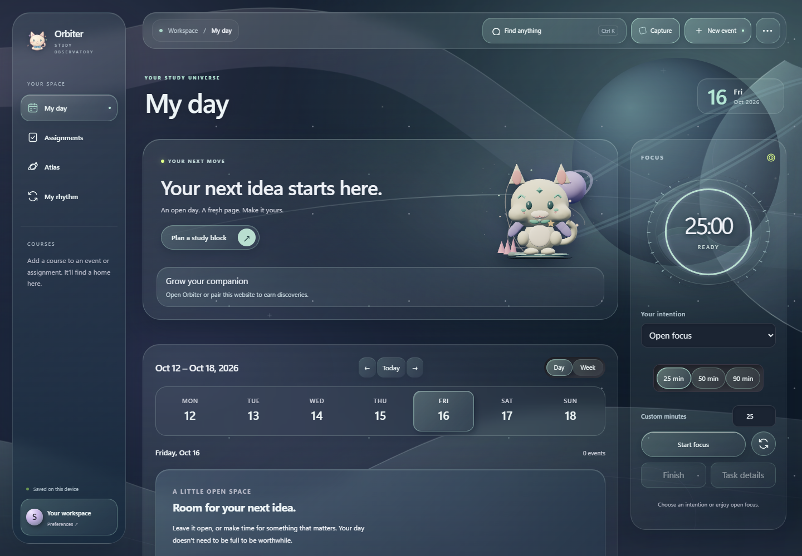

# Orbiter 0.6.0 · A little universe, earned

An original collectible kitten, larger discoveries, and cosmic worlds that respond to you.

## Meet the new kitten

The companion now uses an original Blender-built 3D asset with sculpted cheeks, a friendly smile, a lightweight articulated rig and blink shape keys. Your course cats retain their coat, ears, scarf and charm identities through every growth stage.

## Discoveries worth showing off

- Earned appearances coordinate coat tint, markings and scarf colors.
- Accessories have stronger silhouettes; trails form orbital ribbons and stars.
- Habitats surround your cat with scenery, a distant planet and a soft shader nebula. Equipped habitats also color the wider workspace and buddy island.
- Try owned or locked items before equipping. Cancel or Escape restores your current look; locked previews cannot be equipped.
- Discoveries summarizes your equipped collection. Existing ownership, crate timing and odds are unchanged.

## Three cosmic worlds

Tidal Night, Lunar Mist and Opal Dawn gain layered nebula colors, a ringed planet, stars and bounded cursor parallax. Appearance settings separate decorative atmosphere from motion intensity, with Auto, Low and High graphics quality.

## Everyday study improvements included

Includes the unpromoted 0.5 refinement: coordinated intention and timer controls, appearance previews with Apply/Cancel/Reset, selective wave transitions, growing habitats and non-blocking session recaps. Confirmed account recaps now use authoritative account growth totals.

## Installation and data

The Windows per-user installer bundles the application and model. No Blender, Python, Node, development server or browser window is required to run Orbiter. The database identifier and existing study/reward data are retained.

Save your edits and choose **Quit Orbiter** from its tray menu before installing. Closing the window alone leaves Orbiter running. This personal build has an updater signature using the existing update key, but is **not Authenticode signed**.

## Validation status

See [the local verification report](VERIFICATION-0.6.0.md) for measured results and remaining release gates. Live cross-device account sync, installer upgrade on the user's active profile and physical multi-monitor/scaling checks must be completed before release promotion. Source changes and release artifacts are local; this work does not publish a GitHub release or deploy cloud migrations.
