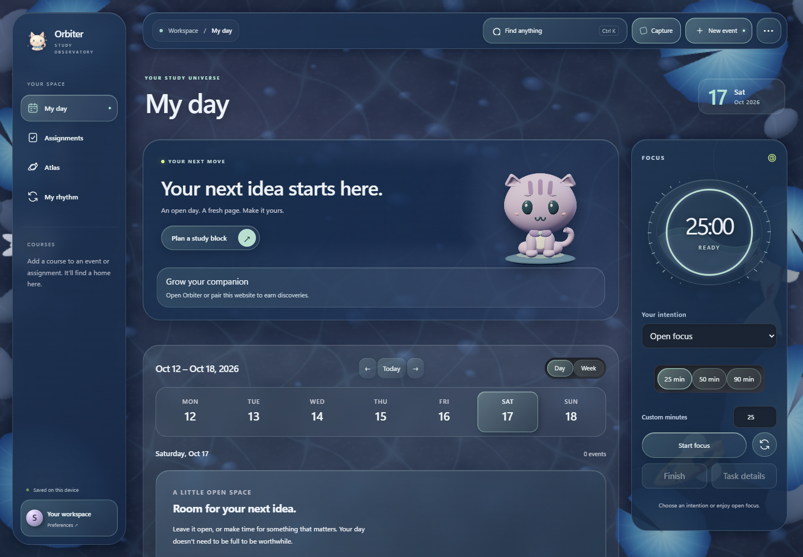

# Orbiter 0.6.2 · your own observatory

Recreated the three environments as abstract light sculptures with translucent folds and a quieter reading plane:

- **Tidal Night:** teal aurora folds, violet illumination and fine contour filaments.
- **Lunar Mist:** silver light veils and sweeping lilac contours.
- **Opal Dawn:** peach/rose illumination and translucent opal folds.
- Replaced the old ribbon/sculpture background and repeating dot grid with original vector scenes and seeded star placement.
- Kept bounded cursor parallax, atmosphere strength, material preferences and earned habitat lighting. The abstract composition scales across desktop and phone layouts.
- Matched the compact buddy's background and the appearance previews to the selected environment.
- Includes the 0.6.1 kitten refinement: smooth cheeks, recessed ears, larger eyes and a seated silhouette.

The backgrounds use no extra WebGL context, runtime downloads, animated filters or continuous planner animation loop. Their desktop and phone compositions were rendered and visually reviewed. No new automated test suite or native performance measurement was run for this art update; the previously reported memory limitations and live release gates remain open.

Save your work and **Quit Orbiter from the tray** before installing. The personal installer is not Authenticode signed; updater artifacts use the existing verification key. Data, cat identities, inventory and reward rules are unchanged. Source changes remain uncommitted; this build does not publish or deploy anything.

## Abstract environment refinement

Replaced the literal planets with translucent aurora folds, layered contour filaments and diffuse teal, silver or rose illumination. Cursor motion separates depth layers and guides a light field; clicking open space creates a short decorative ripple. Controls remain stationary, ripple count is bounded, and reduced motion suspends effects. Matching abstract folds appear in buddy mode. Regenerated desktop/phone art compositions; no new regression or resource measurement was performed.
